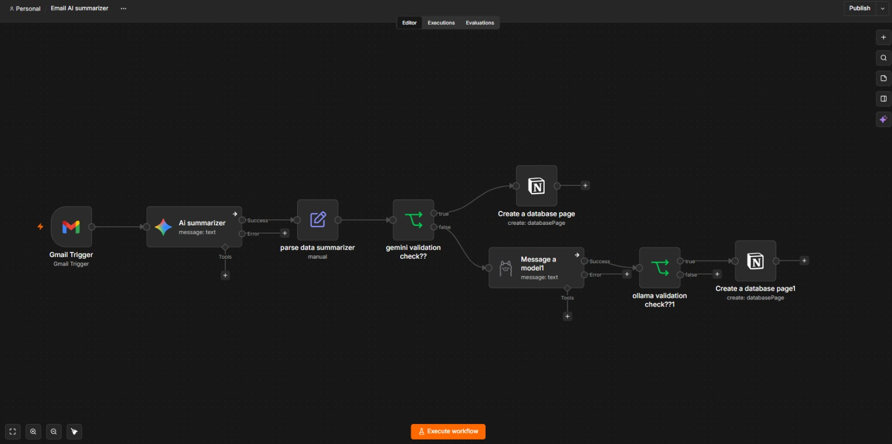

# AI Email Summarizer

An n8n workflow that automatically summarizes incoming Gmail emails with AI and saves the summaries to a Notion database. It uses Google Gemini as the primary model and a local Ollama model as a fallback.





## Overview

1. **Gmail Trigger** detects each new incoming email.
2. **AI Summarizer** (Google Gemini) generates a summary of the email.
3. **Parse Data** formats the summary into clean fields.
4. **Gemini Validation Check** confirms the summary is valid.
   - **Valid:** the summary is saved to Notion.
   - **Not valid:** the email is sent to the fallback model.
5. **Fallback Model** (Ollama, runs locally) generates a new summary.
6. **Ollama Validation Check** confirms the fallback summary is valid.
   - **Valid:** the summary is saved to Notion.

## Tech Stack

| Component | Purpose |
|-----------|---------|
| n8n | Workflow automation |
| Gmail | Email trigger |
| Google Gemini | Primary summarization |
| Ollama | Local fallback summarization |
| Notion | Storage for summaries |

## Getting Started

### Prerequisites

- An n8n instance (self-hosted or cloud)
- A Gmail account connected to n8n
- A Google Gemini API key
- Ollama installed locally with a model pulled
- A Notion integration and a database to store summaries

### Installation

1. Clone this repository.
2. In n8n, select **⋯** → **Import from File** and choose `workflow.json`.
3. Add credentials in n8n for Gmail, Google Gemini, Ollama and Notion.
4. Select your Notion database in both **Create a database page** nodes.
5. Publish the workflow.

## Repository Structure

```
.
├── workflow.json    # Exported n8n workflow
├── workflow.png     # Workflow screenshot
└── README.md
```

## Security

No API keys or secrets are stored in this repository. All credentials are managed within n8n.

## Author

**Yogesh Dobliyal**
